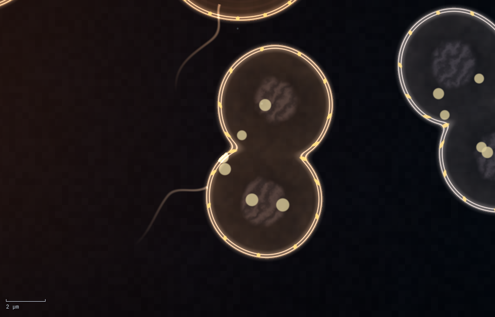

# Primordia

An open-ended evolution simulator that starts from a single ancestral cell
(LUCA) at hydrothermal vents on an early-Earth seafloor. It doesn't hardcode
any traits, cell types or organisms. It only defines the laws of physics and
chemistry, plus a genetic code. Everything else (metabolism, size, behaviour,
temperature preference, gene regulation) evolves.



## Running it (macOS)

1. Install Rust (one time):

   ```bash
   curl --proto '=https' --tlsv1.2 -sSf https://sh.rustup.rs | sh
   ```

2. Download the code (this also installs Apple's command line tools if
   macOS asks, which Rust needs too):

   ```bash
   git clone -b claude/adoring-cray-254z6c https://github.com/aidenyjin/evolution.git
   ```

3. Go into the folder and run it:

   ```bash
   cd evolution
   ```

   ```bash
   cargo run --release
   ```

   `cargo` has to be run inside the folder that contains `Cargo.toml`,
   otherwise it reports "could not find Cargo.toml".

The first build takes a minute or two. Primordia then opens
`http://localhost:4747` in your browser (Safari, Chrome and Firefox all work).
Leave the terminal open while it runs, and press `Ctrl+C` to stop it.

Useful options (put them after `--`):

```bash
cargo run --release -- --seed 42 --port 5000 --no-open
```

You can also start with any setting changed, e.g. `cargo run --release -- atm_o2=1.2`.
Run `cargo run --release -- --params` to list every setting.

## Controls

| | |
|---|---|
| Scroll / pinch | Zoom (cells reveal more detail the closer you get) |
| Drag | Move around |
| Click a cell | Inspect it: energy, metabolism, proteins, genome down to codons |
| Double-click | Zoom in on a spot |
| `Space` | Pause / resume |
| `.` | Advance one frame while paused |
| `1` `2` `3` `4` | Real time · Every 5th · Every Nth · Max |
| `F` | Follow the selected cell (jumps to a daughter when it divides) |
| `P` | Hide/show the side panel |
| `H` | Hide all UI |
| `0` | Fit the whole world on screen |
| `Esc` | Deselect |

**Speed modes.** Every simulation step always runs at full accuracy. The
modes only change how many steps happen per drawn frame:

- **Real time:** draws every step, 60 steps per second.
- **Every 5th:** draws every 5th step. The custom mode draws every *N*th.
- **Max:** simulates as fast as your Mac can and draws ~30 frames per second.

The browser interpolates between frames, so motion stays smooth in every mode.

Biology is sped up relative to motion. A cell divides roughly once a minute at
real time instead of every 20+ minutes. The top bar shows simulated time.
**Settings → Enzyme speeds → Biological pace** slows biology down or speeds it
up while keeping all the ratios.

## What is fixed and what evolves

**Fixed (the laws of this universe)**

- **World.** A strip of seafloor running from deep ocean through shallow ocean
  to a wet beach.
  - The deep is dark and cold, with hot vents releasing H₂ and H₂S.
  - Shallow water is bright and mild.
  - The beach is the brightest and warmest, and gets the most minerals from
    land runoff, but waves surge back and forth over it.
- **Water.** Dissolved chemicals diffuse and are carried by slow currents and
  waves. Gases exchange with the atmosphere, and minerals are slowly
  resupplied. Dissolved organics (sugar, acetate, dead-cell matter) slowly
  wash out into the wider ocean, so food can't pile up forever. Phosphate is
  scarce, which is what limits life in real oceans too.
- **A changing environment.** Nothing stays put for long, which keeps
  evolution moving:
  - **Vents age and die.** As one fades, a new one opens nearby along the
    same seafloor fissure. Life has to follow it or perish.
  - **The climate drifts.** Ocean temperatures slowly swing warmer and colder
    over a long cycle.
- **Chemistry.** There are 10 dissolved species plus reactive oxygen inside
  cells, and 14 possible reactions. The energy each reaction releases is
  derived from real formation free energies (ΔGf), so evolution can't find a
  perpetual-motion loop. For example, aerobic respiration yields ~5.7 ATP per
  carbon and fermentation ~0.4, a better-than-10× gap like the one on Earth.
- **Physics.**
  - **Low-Reynolds-number motion.** Microbes don't coast; they stop as soon as
    they stop pushing.
  - **Brownian motion** from the Stokes–Einstein relation.
  - **Soft membranes** that flatten where cells touch.
  - **Crowding.** Cells squeezed by their neighbours stop growing, as real
    bacteria under mechanical pressure do.
  - **Dormancy.** Cells that can't metabolise (too cold, too hot, or out of
    energy) slow their upkeep and wait, instead of starving at once.
  - **Membrane permeability.** Gases cross membranes on their own; ions and
    sugars need transporter proteins.
- **The genetic code.**
  - Genes are strings of codons. A fixed "folding" rule turns each codon
    sequence into a protein with a shape in a 4-D *shape space*.
  - Every possible function has a site in that space: each enzyme reaction,
    each transporter, motor thrust, and gene regulation.
  - A protein carries out whatever functions its shape lands near, with weak
    side activities on related functions, as real enzymes have.
  - Like the real code, the 2nd base mostly controls hydrophobicity (membrane
    vs. cytoplasm), the 3rd base matters least ("wobble"), and G/C at the 3rd
    position makes proteins more heat-stable.

**Evolves**

- **Genomes.** They undergo point mutations, insertions and deletions, gene
  duplication and loss, and brand-new genes arising from random DNA.
- **Gene expression.** Promoter strengths decide how much of the finite
  proteome each protein gets. Ribosomes take their share too, so a cell trades
  growth machinery against enzymes.
- **Regulators.** Regulator proteins can evolve that sense a molecule (or the
  cell's energy level) and switch other genes on or off.
- **Temperature optimum** of every protein.
- **Universal machinery settings,** such as ribosome level and division size.

The ancestor follows what genetic studies suggest about the real LUCA. It's an
anaerobic, heat-loving vent-dweller (its enzymes work best around 56 °C) that
makes ATP from 4 H₂ + 2 CO₂ → acetate, fixes carbon with H₂, and imports
ammonium and phosphate. Like early enzymes are thought to have been, its
proteins are sloppy generalists, only about half as good as they could be,
so evolution has room to improve them from the start.

Everything after that has to be discovered: cooler temperature preferences,
better enzymes where speed actually matters (cells starved of hydrogen are
limited by how fast it reaches them, not by enzyme speed), fermentation, sulfate reduction, photosynthesis,
oxygen-making photosynthesis, and respiration once oxygen exists. In testing,
most worlds evolve several new abilities within the first simulated hour,
and oxygen-making photosynthesis often appears in that time too. Discoveries,
vent changes and your own edits are logged in the **Discoveries** tab.

## Science-y views

- **Overlays.** Any dissolved chemical, plus temperature, sunlight and water
  currents.
- **Cell colours.** By energy source, by lineage (colours drift slightly with
  each mutation, so relatives look alike), by ATP level, by damage, or by
  genome size.
- **Graphs.** Population by energy source, births and deaths, deaths by cause,
  enzyme quality, world chemistry (log scale), genome size, surviving
  lineages, temperature preference vs. water temperature, cell size and
  generations.
- **Inspector.**
  - Each gene's protein with its best function and side activities, plus its
    location, temperature optimum and expression level.
  - Any regulator wiring.
  - The full codon sequence.
  - A plot of where the cell's proteins sit in shape space.

## Cell editor

The **Editor** tab lets you design new cells and place them in the world, or
rewrite a living cell. Since traits come from genes, you edit genes and the
simulation works out what each protein does.

- **Start from** LUCA, a blank cell, or a copy of the selected cell, or edit
  the selected cell directly (also via **Edit** in the Cell tab).
- **Add a gene by function.** Pick a job (any reaction, transporter, motor or
  regulator), a temperature preference, a length and a location. The editor
  searches for DNA whose protein folds into that function. You'll see its
  real activity and side activities.
- **Edit DNA directly.** Every gene's codons are editable, with a live preview
  of what the protein becomes. You can also edit its expression level and its
  regulator binding site, duplicate it, redesign it, or remove it.
- **Everything else:** ribosome level, division size, lineage colour, and the
  cell's state (size, energy, damage, DNA copied, internal chemicals).
- **Place** any number of cells by clicking in the world (`Esc` to stop), or
  **Apply** your changes to the cell you're editing. The simulation pauses
  while you edit a living cell. Your changes are logged, and abilities you
  add by hand are never credited to evolution.

## Settings

All 138 constants are adjustable live from the **Settings** tab, each with
units and an explanation. Settings marked **new world** apply when you create
a new world. Presets include *After the Great Oxidation*, *Day and night*,
*Fast evolution*, *Rich vents*, *Stable world* (no climate change, vents last
forever) and *Harsh world*.

Worlds can be saved and loaded (top bar). Save files go in `saves/` in the
folder you started from.

## Headless mode

For experiments without the browser:

```bash
cargo run --release -- --headless --steps 216000 --seed 7
```

This prints population, genome and chemistry statistics and the discoveries
log. 216,000 steps is one simulated hour.

## Performance

The simulation runs on all CPU cores, and the browser does the rendering on
the GPU. A typical world settles at a few hundred cells and runs at many
times real time in Max mode.

**Settings → Growth & division → Population cap** (default 1,200) is the most
cells a world can hold. At the cap, cells wait to divide instead of swelling.

A MacBook Air has no fan, so it slows itself down under long full load. Keep
it plugged in for long runs.

## Roadmap

1. ~~World, chemistry, LUCA, life cycle, mutation, browser UI~~ (this release)
2. Sensing and behaviour: chemotaxis via receptor proteins
3. Adhesion, colonies, cell specialisation → multicellularity
4. Engulfment and endosymbiosis (swallowed cells becoming organelles)
5. Generated coastlines with islands and bays
